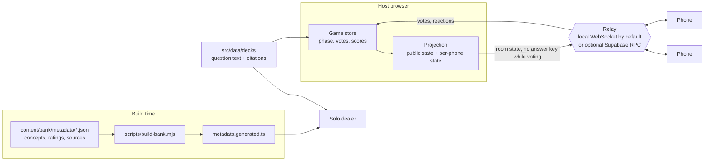

# Vax or Fiction

**Can players make an informed vaccine call from accurate, current evidence without the game leaking the answer or shutting out phone and keyboard users?**

**Short answer:** the software side holds up in automated tests, but the clinical side is not proven yet. Clinical review by Kevin Madden, PharmD is pending, and no human pilot has been run.

The showcase is one eight-question influenza round. Each question has a claim, a true or false answer, an exact quote from a CDC page, saved with its retrieval date and hash, and a link to that page.

### How we test it

| Question | How it is tested | Result now | Limit |
| --- | --- | --- | --- |
| Is every fact backed by a public source? | Each of the 8 questions and the opening and closing text is tied to a saved CDC quote. A check fails if a quote, hash or link changes. | 8 of 8 questions have a saved quote. All 6 links loaded and still held their quotes on 2026-11-01. 0 of 8 reviewed by a clinician. | The link between a sentence and its quote is assigned by hand, not checked by meaning. Clinical accuracy is N/A until Kevin reviews. No second reviewer. |
| Does the game hide the answer until the reveal? | Tests check what reaches phones before the reveal and that the phone's built files hold no answer key. | Pass. A separate live probe of phone messages and the host screen in all 8 voting phases also found no leak. | The public evidence page and review sheet show the answers on purpose. This is a fixed public round, not a blind test. |
| Can phone and keyboard users play? | Browser tests at 390x844 and 430x932, light and dark, plus keyboard reveal, source access and focus return. | All pass in headless Chromium. | No real phones, screen readers or players yet. |
| Does scoring work? | An all-correct bot and an all-wrong bot play the round. | 950 points and 0 points, as expected. | Binary questions only. |

### Limits

These are automated software checks on committed files. They do not show that the content is clinically correct, that players learn from it, or that it changes anyone's vaccine choices. Content may go out of date after the retrieval date. One source (the Pink Book chapter, 2021) carries a CDC warning that it may be outdated. Kevin has not reviewed any question yet, there is no second clinical reviewer, and the four-player pilot has not been run.

### Where to look

Run locally (see below) and open `/showcase/index.html` for the evidence, source chips and the full error list, with a button to host the round. Kevin's phone-friendly review sheet (approve, flag with a note, or skip per question) is at `/clinical-review/index.html`. More detail: [workflow](docs/SHOWCASE.md), [verification](docs/SHOWCASE-VERIFICATION.md), [how it was built](docs/HOW-BUILT.md), [media](docs/media/README.md). The other 142 questions in the bank are outside this review. The full repository gate (`npm run check`) fails on main and on this change in the short-phone layout suite. See the verification report.

A game for talking through immunizations. One screen hosts the show, the room calls true or false (or picks the
better reply, the myth, the number or the order) on their phones, and every reveal shows the public source behind the
answer. There is also a solo mode for one player.

This is an educational game, not medical advice. Questions cite public sources (mostly CDC, plus FDA, WHO and NLM
pages). They have not had clinical review.

## Problem

Vaccine guidance changes often: age cutoffs move, products change, old contraindications go away. The people who
answer patients' vaccine questions, and the people who teach them, need to practice the current rules and the
wording of a good reply, not just read them once. A slide deck does not check what the room actually believes, and a
quiz app does not start a conversation. This game puts a claim on a shared screen, collects everyone's call before
the reveal, then shows the evidence and a one-line takeaway. The question bank is built so that a topic can be
replayed without repeating itself and so that difficulty is deliberate, not accidental.

## How it works



- **One authoritative host.** The host's store owns the game. Phones get a projection: the public room state (no
  answer key while voting is open, and opaque re-shuffled tokens for order questions, since the order is the answer)
  plus their own vote, result and rank. Every message is validated against an exact key list on both ends.
- **Relays.** `npm run dev` attaches a local WebSocket relay to the Vite server, so a host tab and phone tabs play a
  real room with no other setup. An optional Supabase backend (`supabase/migrations/`) runs the same protocol through
  one security-definer Postgres function called with the publishable key, with per-network room budgets. Solo mode
  needs neither.
- **Question bank.** Player-facing text and citations live in 13 deck modules. Everything about a question lives
  beside it in a metadata sidecar: its concept, rotation role, difficulty and the ratings behind it, skill, audience,
  tags, and a review-by date set from how quickly its kind of guidance changes. Details in
  [docs/QUESTION-BANK.md](docs/QUESTION-BANK.md), architecture in [docs/ARCHITECTURE.md](docs/ARCHITECTURE.md).

### The question bank

- **Concepts.** 150 distinct questions map to 121 concepts in `content/bank/concepts.json`. Two questions that test
  the same idea share a concept, so a round never deals both.
- **Rotation.** 88 questions are `core` and 62 are `alternate`. A solo round plays a topic's whole rotation: every
  core question plus each alternate whose concept is not already covered. On a second play each core question with a
  same-kind twin swaps it in, so the length and kind mix stay the same and the content changes.
- **Difficulty rubric.** Four levels (easy, medium, hard, expert) defined against a mixed room, with an accuracy band
  per question kind that corrects for guessing (a true or false question is right half the time by chance). The
  rubric separates three calls: the level, wording flags (jargon, a buried hinge, a giveaway), and defects (a wrong
  or stale key). See [docs/QUESTION-DIFFICULTY-RUBRIC.md](docs/QUESTION-DIFFICULTY-RUBRIC.md).
- **Dealing.** The solo dealer orders a round with the fewest same-kind neighbors the counts allow, and fills the
  first, middle and last thirds with easier to harder levels where the pool supports it.
- **Sources.** All 180 question appearances cite at least one source, 80 distinct URLs in total. The stage shows the
  source on the evidence card after each reveal.

The difficulty ratings in the metadata were made by AI model raters following the rubric, and each record names the
model and run. They estimate how hard a question is. They are not a check on whether it is correct.

## Evidence

All commands below were run on 2026-10-30 on macOS (Apple silicon), Node 24.14.1, Playwright 1.61.1 (Chromium and
WebKit).

| Command | Result |
| --- | --- |
| `npm test` (unit) | 1,331 tests, 1,331 pass |
| `npm run lint` (oxlint) | 0 errors, 25 warnings |
| `npm run build` (`tsc -b` and `vite build`) | passes |
| `npm run check` | 1,331 unit tests plus 312 integration and browser tests across 28 test steps, 8 standalone script checks, lint and build. See the note below. |
| `npm run check:db` | not run here: it needs a local PostgreSQL 17 |

`npm run check` covers the local relay with real WebSockets, the Supabase relay and archive clients against in-process
HTTP fixtures, the security suite, five checks on the built output (phone bundles carry no presenter cues, site pages
are separate chunks, static routing and the 404, no build manifest by default, no gmail address in any built JS asset), and
browser suites in Chromium and WebKit: phone layouts from 320 to 430 px wide, keyboard and clicker ownership, focus
handling, the HUD, and WCAG AA contrast for every word in every look.

Note on the full run: two browser tests are timing-sensitive under heavy machine load (one animation-sampling test in
`test:flavor`, and the first test in `test:topic-patterns`, which checks fade durations and that a pattern tile is
fetched once). Each failed in some full runs on a machine with a load average above 150 and passed on re-run: 3 of 3
times each in isolation, and the whole `test:topic-patterns` file 15 of 15 on its third full run. Every other step
passed. The run stops at its first failing step, so the steps after `test:flavor` were run on their own.

**Rater agreement, measured from the shipped metadata.** Method: for each of the 150 records, compare the two
independent rater levels (`rater-a`, `rater-b`) on the four-level scale. Both raters were instances of the same model.

| Measure | Value |
| --- | --- |
| Exact agreement | 127 of 150 (84.7%) |
| Within one level | 150 of 150 |
| Linear-weighted Cohen's kappa | 0.81 |
| Records needing an adjudicator (split, or both raters unsure) | 47 |

Final levels: easy 73, medium 53, hard 19, expert 5.

## Design decisions and tradeoffs

- **Metadata as a sidecar, not inline.** Tuning a level never touches player-facing text, and a question shared by two
  decks carries one record. The cost is a join step and a coverage test that keeps the two in step.
- **The host is the only source of truth.** Phones render projections and send intents. It keeps scoring and answer
  keys off the wire, at the cost of the host tab having to stay open for the whole game.
- **Polling RPC instead of a realtime channel for the hosted relay.** One Postgres function owns validation,
  budgets and retention, so there is no second server to run. The tradeoff is latency and request volume compared with
  a socket.
- **Points follow the question kind, not its difficulty.** A rating change never changes anyone's score, so ratings
  can move without making old games incomparable.
- **Difficulty rated by AI raters against a written rubric, with an adjudicator.** It made rating 150 questions
  practical and leaves a reason on every record. Two instances of one model are not independent judges, so play data
  should eventually replace these levels.

## Limits

- No clinical review. Sources are cited per question, but no clinician has checked the content, and guidance can
  change after a source's accessed date. Every record carries a review-by date, and a unit test fails once any of those dates has passed.
- Difficulty is not tuned from play. The rubric describes the rule, but the game records no per-question answer data.
- No host-side adaptive difficulty and no cross-topic adaptive solo round.
- Phone rooms need a relay. A static deploy with no relay configured serves solo play and the hands-up offline mode
  only.
- The hosted relay and admin archive need your own Supabase project. Set the admin user id placeholder in
  `supabase/migrations/20260927160000_vof_recap_privacy_lockdown.sql` before applying it.
- Music was generated with ElevenLabs and the look and pattern art with Gemini image generation. See
  [docs/art/README.md](docs/art/README.md) and the Credits page.

## Run locally

```sh
npm install
npm run dev          # prints a local address, open it
```

Open the root URL and choose Host, Join or Solo. Solo is also at `/play`. To join from a phone on the same Wi-Fi, set
`VITE_JOIN_BASE_URL` to your machine's LAN address (see `.env.example`) so the QR code points there.

```sh
npm test             # unit tests
npm run check        # full local gate, needs Playwright browsers: npx playwright install chromium webkit
npm run check:db     # Postgres suites, need PostgreSQL 17 (set POSTGRES_BIN)
npm run relay        # standalone local relay for a separate build (VITE_WS_URL)
```

Optional hosted relay: copy `.env.example` to `.env.local`, apply `supabase/migrations/` to your own project, and set
`VITE_PRODUCTION_RELAY=true`, `VITE_SUPABASE_URL` and `VITE_SUPABASE_PUBLISHABLE_KEY`. Use the publishable key only.
Anything prefixed `VITE_` ships to the browser.

## Development history

Built September to October 2026 over 1,140 commits in a private repository. The full history includes personal notes and private configuration, so this repository is a cleaned public snapshot. The rater-agreement measurement and this documentation were added for this release in October 2026.

## License

MIT, Copyright (c) 2026 Kevin Madden. See [LICENSE](LICENSE).

Player names in tests and fixtures are fictional. Question content summarizes the public sources each question cites.
IBM Plex fonts are under the SIL Open Font License (`public/assets/fonts/`).
